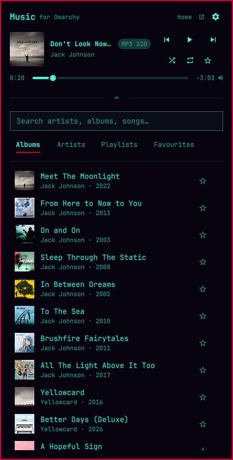
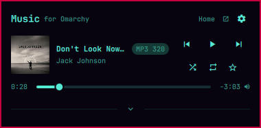
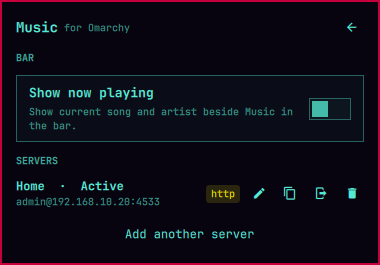

# Music for Omarchy

An [Omarchy](https://omarchy.org) shell plugin that brings a
[Navidrome](https://www.navidrome.org) / Subsonic-API music library into the
bar: search, browse, and play, with transport controls, cover art, and
favourites. Free and open source; no account or subscription beyond your own
server.

[Dromify](https://dromify.app) is a Subsonic client for iPhone, Apple Watch and
Apple TV. This plugin started life as its Omarchy namesake — unrelated code,
same idea, and it follows your Omarchy theme rather than the app's.

This is [dresraz](https://github.com/dresraz)'s fork of
[tallahootie/dromify-omarchy](https://github.com/tallahootie/dromify-omarchy),
renamed to Music. Upstream is unmaintained; the fork is where the work happens
now, and it adds one thing upstream refuses by design: plain `http://` for a
server on your own network (see below).



## Features

- Any Subsonic-API server (Navidrome, Airsonic, Gonic, Ampache in Subsonic
  mode, ...)
- **Multiple servers** — save several by name, switch between them, rename,
  sign out, or remove
- Search artists, albums, and songs
- Browse newest albums, artists → albums → tracks, playlists, and starred
  favourites
- Play/pause, next/previous, seek, shuffle, repeat; the queue is whatever
  list you played from
- The playing track is marked in the list it came from
- Now Playing shows elapsed/remaining time and a pill for what's actually
  streaming — `FLAC`, `MP3 320`, and so on
- Star/unstar from the list or the Now Playing bar
- Cover art, cached locally
- Collapse the browsing view to just Now Playing while something's playing

  
- Streams through `mpv`, so it's a normal MPRIS player: media keys,
  `playerctl`, and Omarchy's Media widget all control it
- One session shared across every monitor — same queue and now-playing
  wherever you open the bar
- Optional bar label for the current song and artist, controlled by the
  **Show now playing** switch in Music settings (off by default); rotated in
  vertical bars, with a tooltip for truncated titles
- Keyboard-driven: `j`/`k` to move, `Enter` to activate, `/` to search, `f`
  to favourite, `r` to refresh, `Esc` to go back
- Passwords live in the desktop keyring (`secret-tool` / libsecret), not in
  a config file; the password and the authenticated stream URLs are passed
  between the helpers over stdin, never on the command line
- Playback recovery restores repeat mode from `mpv` and stores queue/shuffle
  metadata in `~/.local/state/music/queue.json`; stream URLs and tokens
  are excluded
- The server name in the header links to its web UI; each settings row has
  a copy-password button for the first sign-in there

### Multiple servers



The gear in the header opens settings. Each server has switch, rename,
sign-out, and remove; a form at the bottom adds another.

## Requirements

All in Arch's official repos, most already on a stock Omarchy install:

- `mpv` and [`mpv-mpris`](https://github.com/hoyon/mpv-mpris) (`omarchy pkg add mpv mpv-mpris`)
- `curl`, `jq`, `socat`
- `python3` — Omarchy ships it for its own shell helpers, and `bin/music-fsafe`
  (the config/cache writer) is Python
- `wl-clipboard` — ships with Omarchy; used by the copy-password button
- `secret-tool` (`libsecret`) and a running Secret Service — GNOME Keyring
  or KWallet

## Install

```
omarchy plugin add https://github.com/dresraz/Music-omarchy.git --enable
```

Pick a bar section when prompted (default: right). Move it later with
`omarchy bar move dresraz.music --section <left|center|right>`.

By hand:

```
git clone https://github.com/dresraz/Music-omarchy.git \
  ~/.config/omarchy/plugins/dresraz.music
omarchy plugin enable dresraz.music
```

## Use

Click the music-note pill in the bar. It asks for a server name and the
URL/username/password, then remembers you — server details in
`~/.config/omarchy/music/config.json`, password in the keyring. Add or
switch servers from the gear icon.

**Bar pill** — left click opens the panel, right click play/pause, middle
click next.

**Panel** — click an artist/album/playlist to open it, a song to play it.
`j`/`k`/`h`/`l` or arrows to move, `Enter`/`Space` to activate, `Esc` to go
back. `/` searches, `f` favourites, `r` refreshes. Hardware media keys and
`playerctl` work too.

## Server URL: HTTPS, or plain http on your own network

The Subsonic auth scheme sends a salted token (`t`/`s`) with every request.
It's replayable, and the salt is right there for an offline crack of the
password, so it must not travel a network in the clear. Music therefore
**requires `https://`** for the server URL, with two exceptions:

* a **loopback** address — `http://127.0.0.1[:port]` / `http://localhost[:port]`
  / `http://[::1][:port]` — for Navidrome running on the same machine as the
  bar, where there is no network to sniff;
* a server **on your own network**, if you opt in for that profile. Paste an
  `http://` URL in the connect form and an **Allow plain http** toggle appears;
  tick it and the profile is saved with `allowInsecure: true`. From the CLI the
  same thing is `music-api configure --allow-http <name> <url> <user>`.

The opt-in only covers hosts that can't be reached from the public internet:
private ranges (`10/8`, `172.16/12`, `192.168/16`, `169.254/16`), CGNAT and
tailnet addresses (`100.64/10`), IPv6 unique-local and link-local, `*.local` /
`*.lan` / `*.home.arpa`, and bare single-label hostnames. A public `http://`
host is refused even with the toggle on, so a port-forwarded or café-wifi
server can't be reached in the clear by accident. A profile that opted in
carries an `http` badge in the settings list, so it never looks like a normal
one.

What you're accepting: anyone who can sniff that network can lift the token and
use it against your server — browsing and streaming your library, starring,
editing playlists. Not admin. On a trusted home LAN that's usually a fine
trade; on a network you don't control, use HTTPS.

### Getting HTTPS on a home server

Cleanest option, and it doubles as remote access — Tailscale fetches a real
Let's Encrypt cert and terminates TLS in front of Navidrome:

```
# one-time: enable HTTPS certs at https://login.tailscale.com/admin/dns
tailscale serve --bg 4533        # https://<host>.<tailnet>.ts.net -> http://127.0.0.1:4533
```

Then use `https://<your-host>.<your-tailnet>.ts.net` as the server URL — the
same address resolves on the LAN (routed directly) and from anywhere on your
tailnet, no port-forwarding, cert auto-renewed, config persists across
reboots. A reverse proxy with a Let's Encrypt cert (Caddy does this
automatically) or Navidrome's own `ND_TLSCERT` / `ND_TLSKEY` work equally well.

## Remove

```
omarchy plugin remove dresraz.music
```

To also clear saved servers and cache:

```
rm -rf ~/.config/omarchy/music ~/.cache/music ~/.local/state/music
secret-tool clear service omarchy-music
```

## How it's built

Plain Quickshell QML (`Panel.qml`, `Service.qml`) over three small helpers:

- `bin/music-api` — Subsonic REST client: server profiles, browsing,
  search, favourites, cover art, stream URLs.
- `bin/music-player` — drives one persistent `mpv` instance over its JSON
  IPC socket. mpv's playlist is the queue, so next/previous work through
  MPRIS and hardware media keys.
- `bin/music-fsafe` — the only thing that touches config and cache paths:
  openat/`O_NOFOLLOW` walking, size caps, atomic writes.

They run standalone:

```
echo demo | bin/music-api configure Demo https://demo.navidrome.org demo
bin/music-api get getRandomSongs.view size=5
bin/music-player status
```

## Tests

Run the helper-state test with `tests/queue-state.sh`. The live shell-reload
integration test restarts Omarchy shell and requires unpaused Music playback.
Run it explicitly:

```bash
DROMIFY_RUN_SHELL_RELOAD_TEST=1 tests/shell-reload-integration.sh
```

It checks that the same `mpv` process survives, now-playing metadata matches
the saved queue position (allowing playback to advance across multiple tracks),
and Music restores repeat/shuffle state without logging track metadata.

## Licence

MIT — see [LICENSE](LICENSE).
